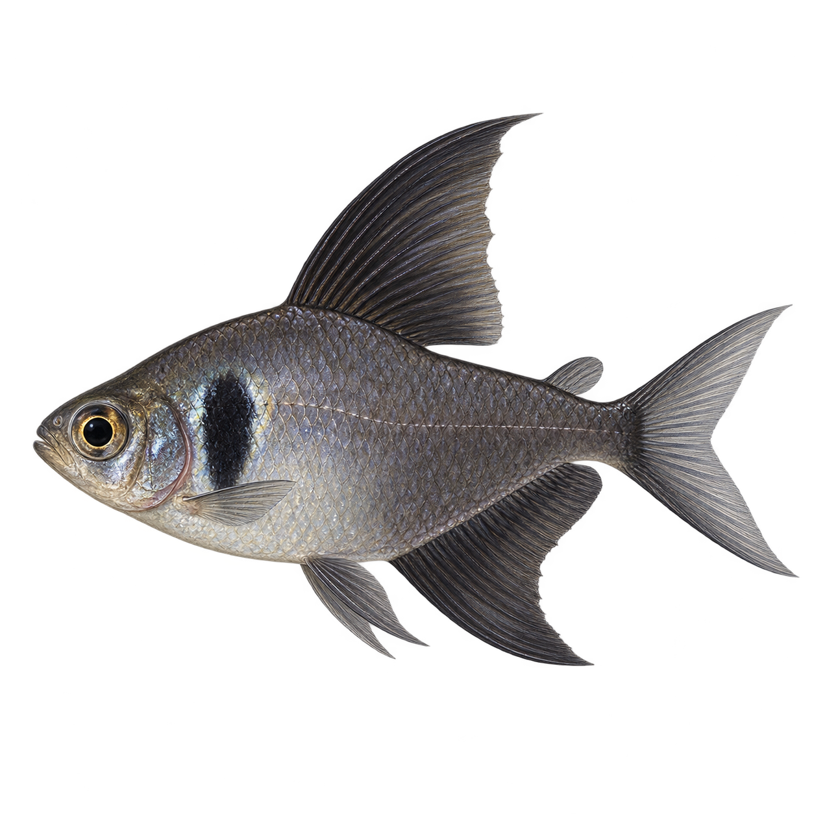
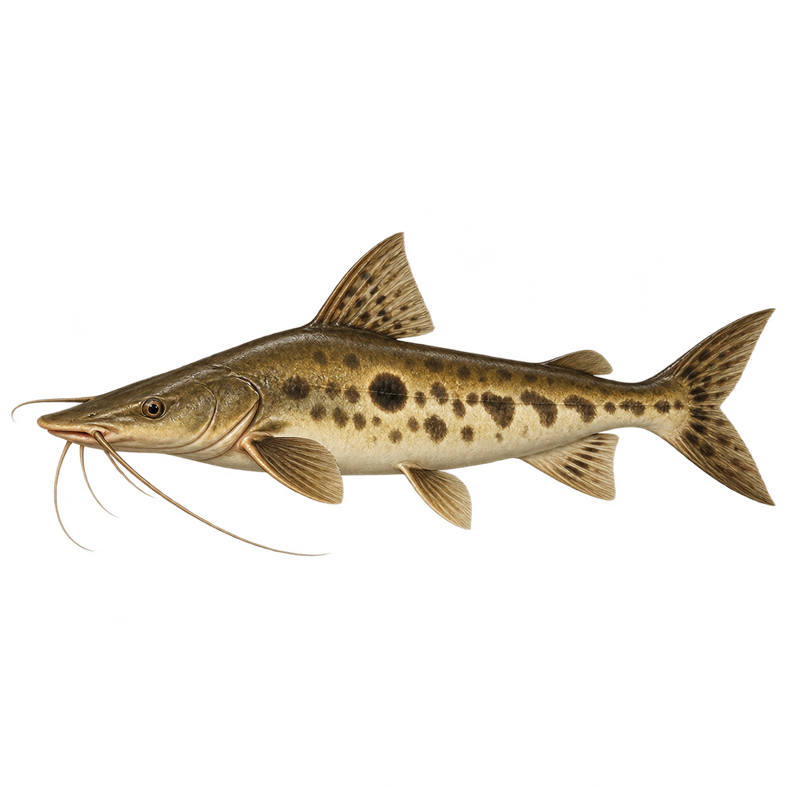
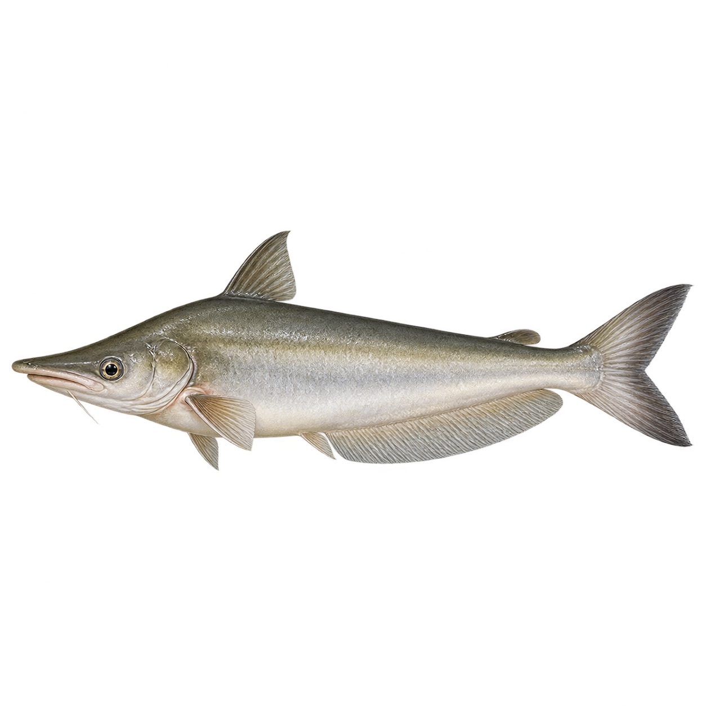
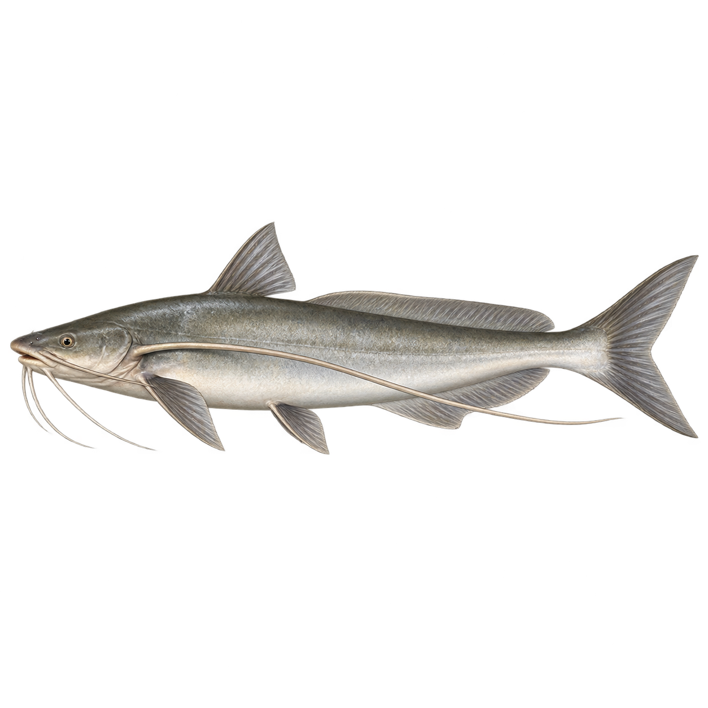
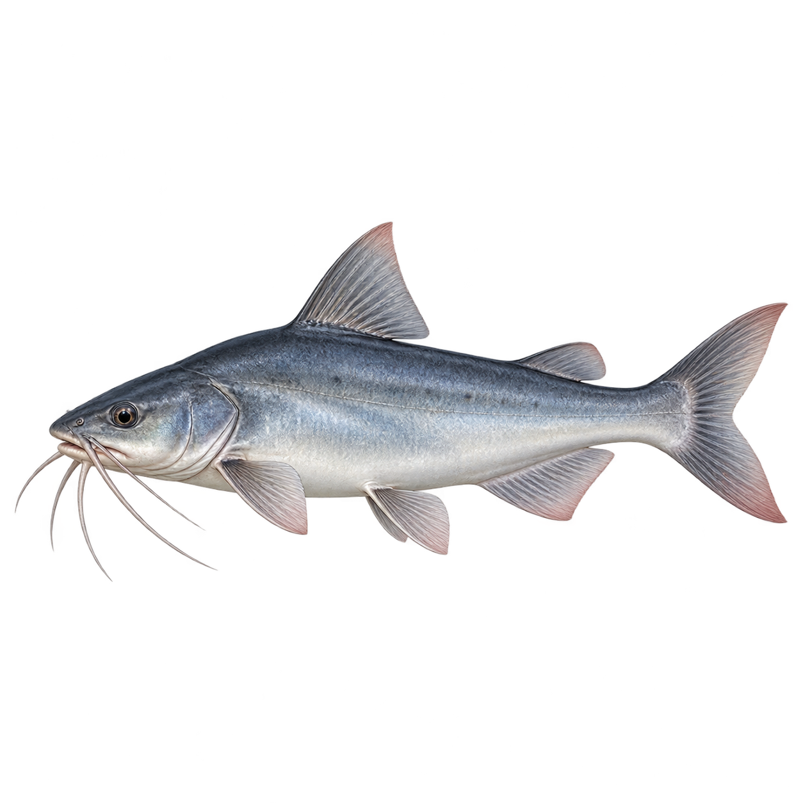
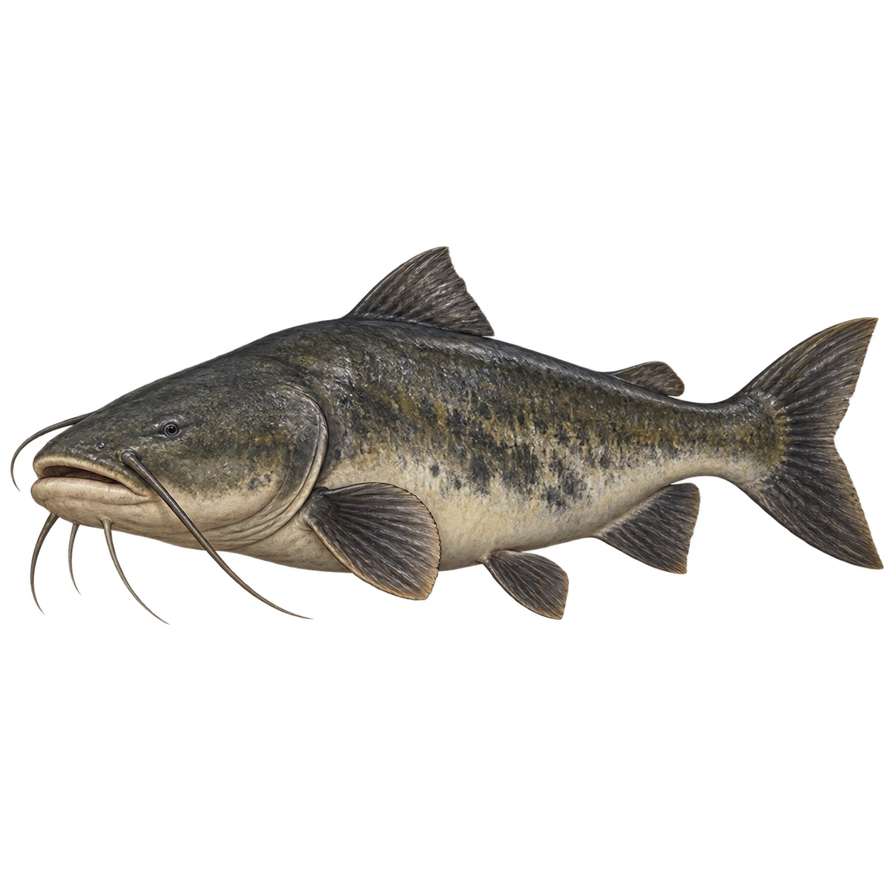
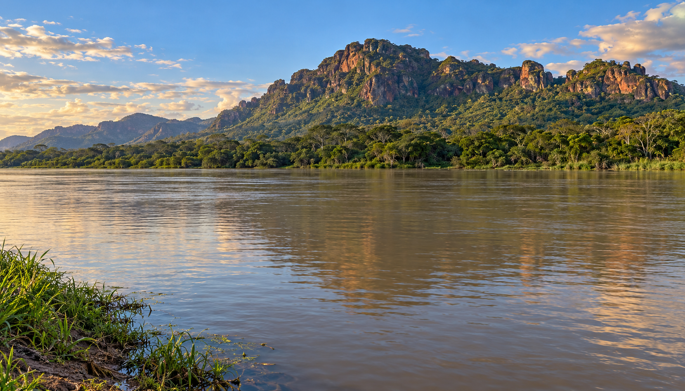

# Ноябрь: Порту-Амолар

**Название, фон, полный пул и все шесть дополнительных рисунков утверждены пользователем 28 октября 2026 года.** Контент интегрирован в develop для выпуска через PR.

- **RU:** Порту-Амолар — 12 знаков; **EN:** Porto Amolar — 12 знаков.
- **Место:** река Парагвай у Порту-Амолар, Серра-ду-Амолар, Пантанал, Бразилия; выше Корумбы по реке.
- [Место на карте](https://www.google.com/maps/search/?api=1&query=Porto+Amolar+Corumba+Brazil).
- Описание: «Река Парагвай у подножия Серра-ду-Амолар. Широкая вода, пойменные леса и скалистые склоны Пантанала».

[Рабочий манифест](../event.json) обновлён и совпадает с [утверждённым event.json](event.json). Каталог, RU/EN-переводы, Mini App, Android WebP и карточки улова подключены. Production ID 5 обновляется после слияния и развёртывания релиза; HDC в этом блоке работ не меняется.

## Состав без двойного подсчёта

**Всего 37 рыб: 13 новых для ноября и 24 старые.** Из 13 новых семь уже подготовлены и одобрены 22 октября; ещё шесть нарисованы сейчас. Все 37 изображений разные.

| Группа | Количество | Рыбы |
|---|---:|---|
| Новые для ноября, уже готовы | 7 | Куримбата; Пирапутанга; Пиавусу; Качара; Скат Фалькнера; Дорадо золотой; Пинтадо |
| Дополнительные рисунки, утверждены | 6 | Чёрный фантом; Журупока; Пальмито; Барбадо; Пати; Жау |
| Старые из каталога | 24 | Сохраняют собственные названия, редкости и картинки; полный список ниже |

Паку краснобрюхий и бикуда остаются существующими игровыми рыбами: карточек «Паку пантанальский» или «Ацестроринх Пантанала» с чужими картинками нет. Качара, дорадо золотой и пинтадо входят в первые семь, повторно их не рисовали. Жау имеет отдельную новую картинку; общий «Зунгаро» в этот пул не включён, чтобы не дублировать близкую роль под двумя названиями.

По уточнению пользователя это игровая подборка с характерными рыбами Пантанала и подходящими пресноводными рыбами Южной Америки. Стопроцентное соответствие всех обитателей одному берегу не требуется; совместное обитание всех 37 видов у Порту-Амолар не заявляется. Новые карточки не создаются ради небольших таксономических или местных различий названий.

## Шесть новых рисунков

| Чёрный фантом · common | Журупока · epic | Пальмито · epic |
|---|---|---|
|  |  |  |

| Барбадо · mythic | Пати · mythic | Жау · legendary |
|---|---|---|
|  |  |  |

Все шесть созданы встроенным imagegen как самостоятельные изображения на прозрачном фоне. Запросы и латинские названия — в [fish-prompts.json](fish-prompts.json). Связь каждого вида с его единственным изображением — в [proposal.json](proposal.json).

## Полный пул

Распределение прежнее: **11 common / 7 uncommon / 7 rare / 5 epic / 4 mythic / 3 legendary**.

| № | Рыба | Редкость | Происхождение карточки |
|---:|---|---|---|
| 1 | Куримбата | common | Новая для ноября, готова |
| 2 | Прохилодус красноштриховый | common | Старая из каталога |
| 3 | Отоцинклюс широкополосый | common | Старая из каталога |
| 4 | Тетра неоновая | common | Старая из каталога |
| 5 | Чёрный фантом | common | Новая для ноября, утверждена |
| 6 | Тетра родостомус | common | Старая из каталога |
| 7 | Тетра лимонная | common | Старая из каталога |
| 8 | Тетра чёрный неон | common | Старая из каталога |
| 9 | Нанностомус трифасциатус | common | Старая из каталога |
| 10 | Мечерот обыкновенный | common | Старая из каталога |
| 11 | Цихлазома мезонаута | common | Старая из каталога |
| 12 | Пирапутанга | uncommon | Новая для ноября, готова |
| 13 | Анциструс обыкновенный | uncommon | Старая из каталога |
| 14 | Тернеция чёрная | uncommon | Старая из каталога |
| 15 | Торакатум | uncommon | Старая из каталога |
| 16 | Коридорас Штерба | uncommon | Старая из каталога |
| 17 | Лепоринус полосатый | uncommon | Старая из каталога |
| 18 | Пиранья краснобрюхая | uncommon | Старая из каталога |
| 19 | Пиавусу | rare | Новая для ноября, готова |
| 20 | Паку краснобрюхий | rare | Старая из каталога |
| 21 | Бикуда | rare | Старая из каталога |
| 22 | Пиранья чёрная | rare | Старая из каталога |
| 23 | Щучья цихлида | rare | Старая из каталога |
| 24 | Рыба-лист амазонская | rare | Старая из каталога |
| 25 | Мечерот пятнистый | rare | Старая из каталога |
| 26 | Качара | epic | Новая для ноября, готова |
| 27 | Журупока | epic | Новая для ноября, утверждена |
| 28 | Пальмито | epic | Новая для ноября, утверждена |
| 29 | Сом веслоносый | epic | Старая из каталога |
| 30 | Павлиний окунь | epic | Старая из каталога |
| 31 | Скат Фалькнера | mythic | Новая для ноября, готова |
| 32 | Барбадо | mythic | Новая для ноября, утверждена |
| 33 | Скат моторо | mythic | Старая из каталога |
| 34 | Пати | mythic | Новая для ноября, утверждена |
| 35 | Дорадо золотой | legendary | Новая для ноября, готова |
| 36 | Пинтадо | legendary | Новая для ноября, готова |
| 37 | Жау | legendary | Новая для ноября, утверждена |

## Утверждённый фон

Фон создан встроенным imagegen по реальным видам Серра-ду-Амолар: скалистые покрытые лесом склоны над широкой пойменной рекой. Это художественная реконструкция местного пейзажа. Центр и нижняя часть оставлены под вываживание и заброс. Запрос сохранён в proposal.json.

## Баланс и публикация

Кандидат сохраняет точные веса прежних позиций. Каждая замена остаётся в той же редкости, пресной воде и игровой группе мирной/хищной наживки; базовые суммы и согласованный образец «Ущелья Колумбии» сохраняются. Облегчение дают только глобальные множители rare ×1,3 / epic ×2 / mythic ×3 / legendary ×3.

Даты прежние: **01.11.2026 00:00 UTC — 01.12.2026 00:00 UTC**, то есть 01:00 по Белграду на обе даты. Награды и зачёты прежние.

Шесть карточек интегрированы с собственными PNG, переводами, Android WebP и картинками улова бота; утверждённый фон и короткое название подключены во всех клиентах. Следующий шаг — выпуск через develop → main и обновление существующего будущего ивента **ID 5** после развёртывания контента. HDC получает готовые локальные артефакты без тяжёлой серверной сборки; новую запись ивента рядом не создавать. Предыдущий Android безопасно продолжает игру: контракт API прежний, неизвестные картинки пропускаются без ошибки. Новый APK нужен для шести новых локальных спрайтов и фоновой иллюстрации.

## Источники

- [Ecoa: Серра-ду-Амолар и Порту-Амолар](https://ecoa.org.br/serra-do-amolar-uma-das-mais-belas-paisagens-pantaneiras/) — место и реальные виды рельефа.
- [Embrapa: SCPESCA/MS](https://www.infoteca.cnptia.embrapa.br/infoteca/bitstream/doc/948598/1/BP118.pdf) — характерные региональные рыбы: барбадо, пати, журупока, жау и другие.
- [Froehlich et al., 2017](https://doi.org/10.1590/1678-4766e2017151) — региональный список, не требование переделывать близкие существующие игровые виды.
- [Пальмито: образец в исследовании](https://neotropical.pensoft.net/article/53383/zoom/fig/12/), [Пати](https://sib.gob.ar/especies/luciopimelodus-pati), [Журупока](https://sib.gob.ar/especies/hemisorubim-platyrhynchos) — ориентиры для самостоятельных новых изображений.
