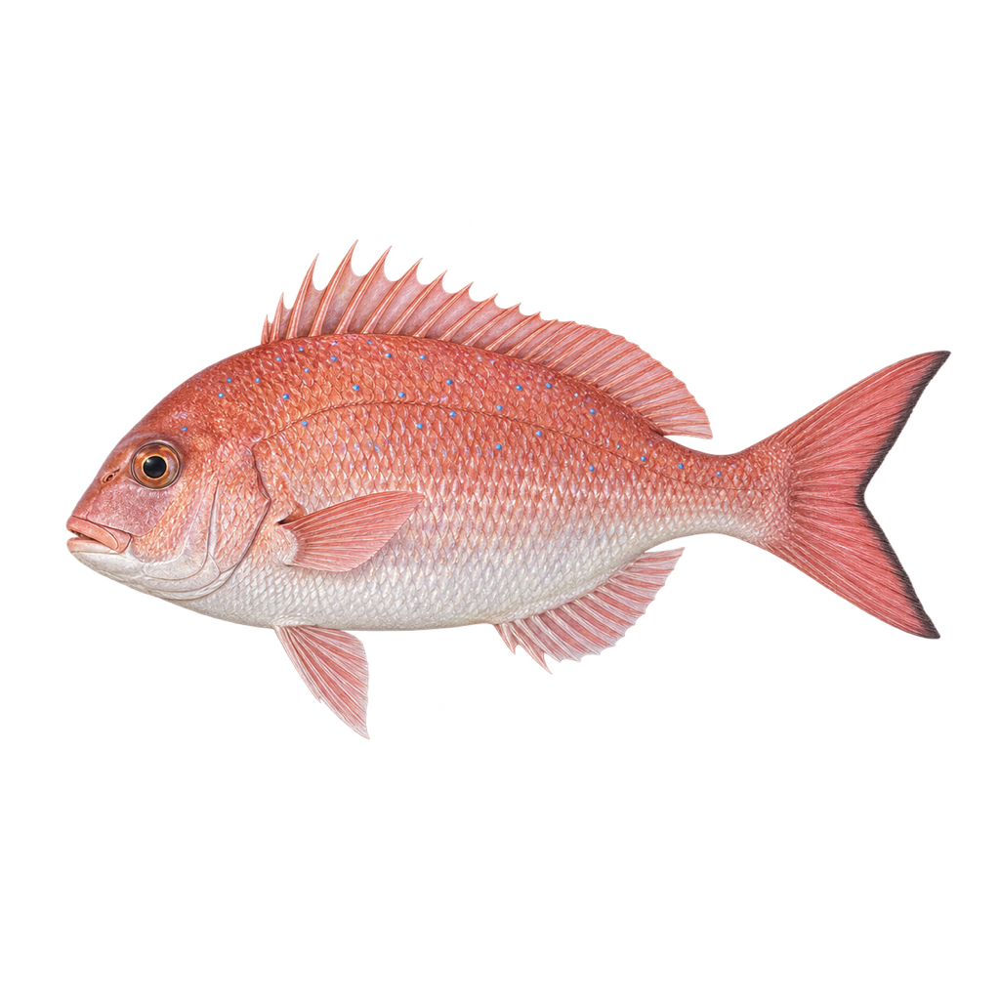

# Декабрь: Тасаки-Каннон

Предложение для согласования по RIV-1. Короткое название локации — **Тасаки-Каннон** / **Tasaki Kannon**. Место — мыс 太崎観音崎 на берегу залива Кагосима (Кинко-ван) в Тарумидзу, с видом на вулкан Сакурадзима. [Место на карте](https://www.google.com/maps/search/?api=1&query=%E5%A4%AA%E5%B4%8E%E8%A6%B3%E9%9F%B3%E5%B4%8E+%E5%9E%82%E6%B0%B4%E5%B8%82)

Предлагаемые границы — **1 декабря 2026, 00:00 UTC** и **1 января 2027, 00:00 UTC**. В Белграде обе границы приходятся на 01:00.

## Фон

Зимняя интерпретация вида с референса владельца: сосны вокруг сцены, закат на склоне Сакурадзимы, иней на вулканических камнях и открытое море. В центре и нижней части кадра оставлена вода для зоны заброса. Сакурадзима и её шлейф остаются видны в центральном портретном кропе.

## Пять новых рыб

| Масаба | Мадай | Татиуо | Исидай | Бури |
|---|---|---|---|---|
|  |  |  |  |  |
| Японская скумбрия | Красный морской лещ | Японская рыба-сабля | Полосатый ножезуб | Японская сериола |

Масаба, мадай и татиуо отмечены в списке рыб залива Кагосима. Исидай дополняет набор как рыба скалистых берегов, а бури выделяется как один из зимних видов префектуры. Подборка охватывает побережье юга Японии и западную часть Тихого океана. В ней есть игровые аналоги и редкие гости открытого моря. [Стратегия биоразнообразия Кагосимы](https://www.city.kagoshima.lg.jp/kankyo/kankyo/hozen/machizukuri/kankyohozen/shizen/documents/dainijiseibututayouseisennryaku.pdf), [рыбы префектуры по сезонам](https://www.pref.kagoshima.jp/af05/sangyo-rodo/rinsui/suisangyo/season/sakana_42780.html), [уловы исидая в заливе](https://kaisei.synapse.kagoshima.jp/noname7.htm)

## Полный пул

**40 морских рыб**. У 35 существующих карточек сохранены названия, редкости и исходный арт. У пяти новых — собственные прозрачные PNG. Распределение по редкости — **12 common, 9 uncommon, 7 rare, 6 epic, 3 mythic и 3 legendary**. «Мирная» и «хищная» в таблице обозначают игровую группу наживки.

| № | Рыба | Редкость | Наживка | Изображение |
|---:|---|---|---|---|
| 1 | Сардина / Sardine | common | мирная | [каталог](../../../../src/main/resources/webapp/assets/fish/sardina.png) |
| 2 | Кефаль пятнистая / Spotted Mullet | common | мирная | [каталог](../../../../src/main/resources/webapp/assets/fish/kefal_pyatnistaya.png) |
| 3 | Анчоус тропический / Tropical Anchovy | common | мирная | [каталог](../../../../src/main/resources/webapp/assets/fish/anchous_tropicheskiy.png) |
| 4 | Сельдь тихоокеанская / Pacific Herring | common | мирная | [каталог](../../../../src/main/resources/webapp/assets/fish/seld_tihookeanskaya.png) |
| 5 | Хромис рифовый / Reef Chromis | common | мирная | [каталог](../../../../src/main/resources/webapp/assets/fish/hromis_rifoviy.png) |
| 6 | Фузилёр жёлтохвостый / Yellowtail Fusilier | common | мирная | [каталог](../../../../src/main/resources/webapp/assets/fish/fuziler_zheltohvostiy.png) |
| 7 | Морской конёк / Seahorse | common | мирная | [каталог](../../../../src/main/resources/webapp/assets/fish/morskoy_konek.png) |
| 8 | Ставрида / Horse Mackerel | common | хищная | [каталог](../../../../src/main/resources/webapp/assets/fish/stavrida.png) |
| 9 | Скорпена бородатая / Bearded Scorpionfish | common | хищная | [каталог](../../../../src/main/resources/webapp/assets/fish/skorpena_borodataya.png) |
| 10 | Барракуда полосатая / Striped Barracuda | common | хищная | [каталог](../../../../src/main/resources/webapp/assets/fish/barrakuda_polosataya.png) |
| 11 | Каранкс шестиполосый / Sixband Trevally | common | хищная | [каталог](../../../../src/main/resources/webapp/assets/fish/karanks_polosatiy.png) |
| 12 | Масаба / Masaba · *Scomber japonicus* | common | хищная | [новая](fish/masaba.png) |
| 13 | Кефаль-лобан / Flathead Grey Mullet | uncommon | мирная | [каталог](../../../../src/main/resources/webapp/assets/fish/kefal.png) |
| 14 | Сайра / Pacific Saury | uncommon | мирная | [каталог](../../../../src/main/resources/webapp/assets/fish/sayra.png) |
| 15 | Летучая рыба / Flying Fish | uncommon | мирная | [каталог](../../../../src/main/resources/webapp/assets/fish/letuchaya_ryba.png) |
| 16 | Барабулька тропическая / Tropical Goatfish | uncommon | мирная | [каталог](../../../../src/main/resources/webapp/assets/fish/barabulka_tropicheskaya.png) |
| 17 | Рыба-бабочка полосатая / Striped Butterflyfish | uncommon | мирная | [каталог](../../../../src/main/resources/webapp/assets/fish/ryba_babochka_polosataya.png) |
| 18 | Губан-чистильщик / Cleaner Wrasse | uncommon | мирная | [каталог](../../../../src/main/resources/webapp/assets/fish/guban-chistilschik.png) |
| 19 | Иглорыл-агухон / Agujon Needlefish | uncommon | хищная | [каталог](../../../../src/main/resources/webapp/assets/fish/igloryl-aguhon.png) |
| 20 | Группер леопардовый коралловый / Leopard Coral Grouper | uncommon | хищная | [каталог](../../../../src/main/resources/webapp/assets/fish/grupper_leopardoviy_koralloviy.png) |
| 21 | Мадай / Madai · *Pagrus major* | uncommon | хищная | [новая](fish/madai.png) |
| 22 | Сиган золотистый / Golden Rabbitfish | rare | мирная | [каталог](../../../../src/main/resources/webapp/assets/fish/zolotistiy_shiponog.png) |
| 23 | Сиган коричневопятнистый / Brown-spotted Rabbitfish | rare | мирная | [каталог](../../../../src/main/resources/webapp/assets/fish/sigan_korichnevopyatnistiy.png) |
| 24 | Альбула / Bonefish | rare | хищная | [каталог](../../../../src/main/resources/webapp/assets/fish/kostlyavaya_ryba.png) |
| 25 | Альбакор / Albacore | rare | хищная | [каталог](../../../../src/main/resources/webapp/assets/fish/albakor.png) |
| 26 | Дорадо / Dorado | rare | хищная | [каталог](../../../../src/main/resources/webapp/assets/fish/dorado.png) |
| 27 | Татиуо / Tachiuo · *Trichiurus japonicus* | rare | хищная | [новая](fish/tachiuo.png) |
| 28 | Исидай / Ishidai · *Oplegnathus fasciatus* | rare | хищная | [новая](fish/ishidai.png) |
| 29 | Каранкс голубой / Blue Trevally | epic | хищная | [каталог](../../../../src/main/resources/webapp/assets/fish/goluboy_trevalli.png) |
| 30 | Рыба-меч / Swordfish | epic | хищная | [каталог](../../../../src/main/resources/webapp/assets/fish/ryba_mech.png) |
| 31 | Барракуда большая / Great Barracuda | epic | хищная | [каталог](../../../../src/main/resources/webapp/assets/fish/barrakuda_bolschaya.png) |
| 32 | Парусник / Sailfish | epic | хищная | [каталог](../../../../src/main/resources/webapp/assets/fish/parusnik.png) |
| 33 | Акула мако / Mako Shark | epic | хищная | [каталог](../../../../src/main/resources/webapp/assets/fish/akula_mako.png) |
| 34 | Бури / Buri · *Seriola quinqueradiata* | epic | хищная | [новая](fish/buri.png) |
| 35 | Тунец желтоперый / Yellowfin Tuna | mythic | хищная | [каталог](../../../../src/main/resources/webapp/assets/fish/tunec_zeltoperiy.png) |
| 36 | Конгер / Conger Eel | mythic | хищная | [каталог](../../../../src/main/resources/webapp/assets/fish/konger.png) |
| 37 | Мурена гигантская / Giant Moray | mythic | хищная | [каталог](../../../../src/main/resources/webapp/assets/fish/murena_gigantskaya.png) |
| 38 | Тунец синеперый / Bluefin Tuna | legendary | хищная | [каталог](../../../../src/main/resources/webapp/assets/fish/tunets_sineperiy.png) |
| 39 | Каранкс гигантский / Giant Trevally | legendary | хищная | [каталог](../../../../src/main/resources/webapp/assets/fish/gigantskiy_karanks.png) |
| 40 | Марлин синий / Blue Marlin | legendary | хищная | [каталог](../../../../src/main/resources/webapp/assets/fish/marlin_siniy.png) |

В [proposal.json](proposal.json) указаны состав и предлагаемые веса. Суммарный вес каждой комбинации редкости и группы наживки совпадает с ноябрьским «Порту-Амоларом». Внутри группы вес распределён поровну с округлением до десяти знаков. Состав рассчитан на морскую наживку. [Ноябрьский манифест](../../2026-11-south-america/event.json)

Фон и пять спрайтов сгенерированы встроенным ImageGen. Точные запросы сохранены в [image-prompts.json](image-prompts.json). Для выпуска после согласования потребуется подключить карточки и фон, подготовить манифест с зоной заброса и наградами, затем проверить ивент на игровых клиентах.

## География

- [Тасаки-Каннон на туристическом сайте префектуры](https://www.kagoshima-kankou.com/guide/52844)
- [Мыс Тасаки-Каннон в геопарке Сакурадзима и Кинко-ван](https://www.sakurajima-kinkowan-geo.jp/cust-facility/7962/)
